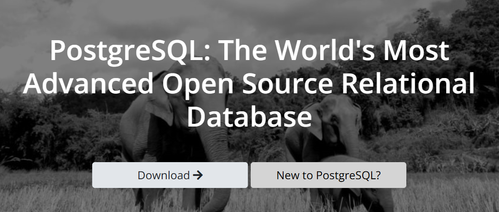
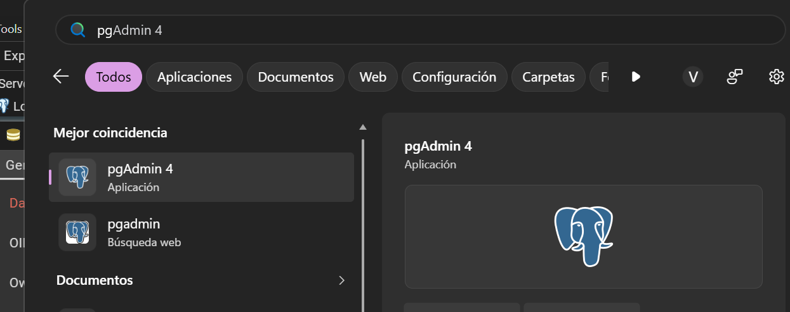
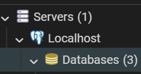
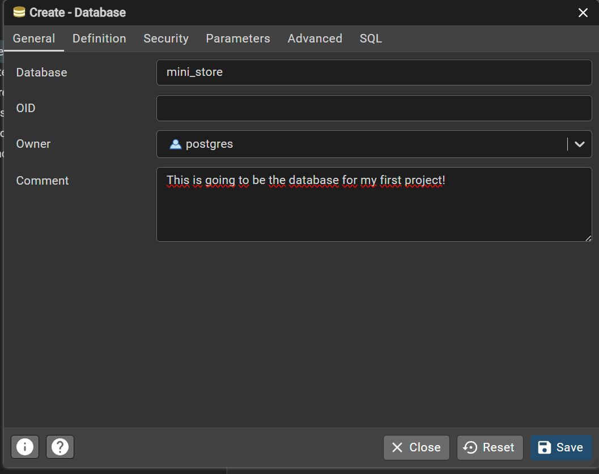

# Welcome to the Store project!
This is a very simple mini-project that will help you to getting started with SQL. In particular with some of the most basic Queries.

## Things you should know before getting started

    
What is Structured Query Language (SQL)?

    Is a programming language used by nearly all relational databases to **query**, **manipulate**, and **define data**, and to provide **acces control**.

    
What is a Data Base?

    A data base is an organized collection of strucured information, or data, typically stored in a computer system.

    
What is a Relational Database?

    Is a type of databases organized as a set of tables with columns and rows.

    
What is a DataBase Management System (DBMS)?

    A database is usually controlled by a DBMS. It serves as an interface between the database and its end users or programs, allowing users to **retrieve**, **update**, and **manage** how the information is organized and optimized.

    
What is PostgreSQL

    PostgreSQL is an open source database system. It is the one we will be usinng during this project! 

## Getting Started with Postgress
For this project, and the majority of them that I will be uploading, we we'll be using PostgreSQL. Soooo if you don't have it installed yet, you may want to use this mini-tutorial to getting started.
1. Go to https://www.postgresql.org/download/windows/ for downlanding PostgreSQL in the Windows operating system. Download it by clicking the button "Download the installer".

2. Execute it and leave everything by default.
    * When it ask for a password for the user `postgres`chose one and write it down.
    * In the port use the 5432
    * If it offers you the "Stack Builder", don't mark it, you don't need it
3. The installer includes **pgAdmin**, a graphic interface we will be using for getting started.  

## Creating the Data base
1. Open **pgAdmin** the the main menu. It will prompt you for the password you choose.
2. In the right panel folow this steps:
    1. Servers
    2. PostgreSQL
    3. Right click in *Databases*
    4. Create
    5. Database
    6. Name it "mini_store"
    7. Save

