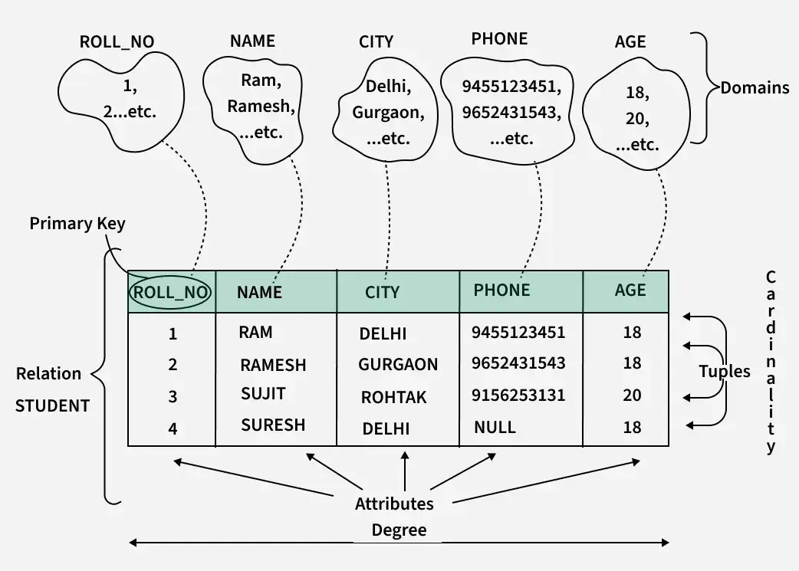
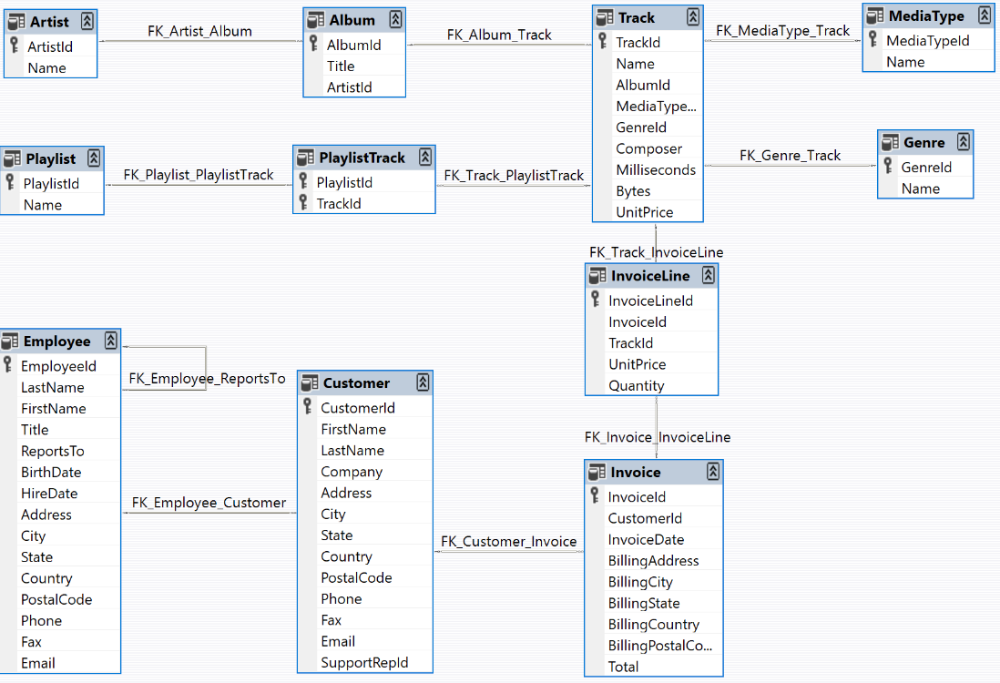

# Components of a Database Table
Databases consist of multiple tables, each containing data organized into rows and columns representing entities and their attributes.
## Columns
Columns represent the *attributes* of the data stored in a table. **Each column** has a specific *data type* that defines the kind of data it can hold.
## Rows
Rows represent individual data entries in a table. **Each row** contains a *unique combination* of values for the columns.
## Primary Key (PK)
A primary key is a **column** or a **set of columns** uniquely identifying each row in the table. It ensures that no two rows have the same primary key value.
## Data Types
Data types define the kind of *data* that can be stored in each column. Common data types include:
* INT
* VARCHAR (NVARCHAR)
* DATA (DATETIME)
* DECIMAL (NUMERIC)
* BOOLEAN
## Constraints
Constraint are **rules** applied to **columns** to enforce *data integrity and consistency*. Common contraints:
* NOT NULL
* UNIQUE
* CHECK
* FOREIGN KEY

# Table Relationships
When talking about tables we have to take into account that they may also be related to each other though keys and relationships.
## Foreign Key
A column or a set of columns in one table that refers to the primary key in another one. It establishes a link between the two tables
## One-to-Many Relationship
A row in one table can be associated with multiple rows in another in a one-to-many relationships
## Many-to-Many relationship
Multiple rows in one table can be associated with multiple rows in another. This relationships are typically implemented using a junction table.

# Entity Relationship Diagram (ERD)
It is a diagram for showcasing how tables within a database are connected. 

