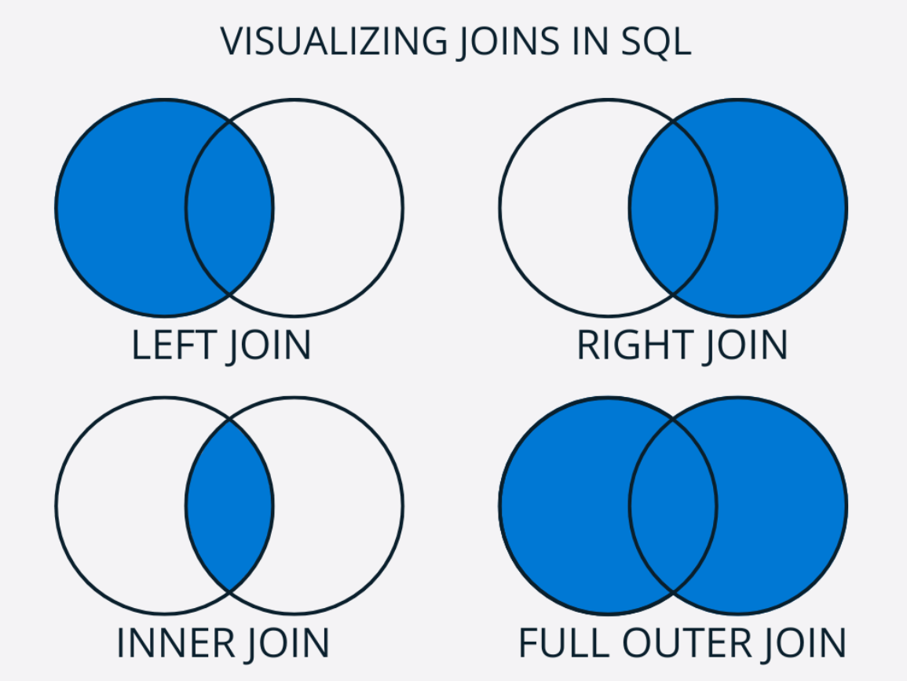

# JOINS in SQL
JOINS allow you to combine rows from two or more tables based on a related column between them.

## Types of JOINS
### INNER JOIN
Also known just as JOIN. It is the most common type of JOIN. It **returns rows when there is a match in both tables**. If there is no match, the row is not returned.

### LEFT JOIN
Returns all rows from the left table and the marched rows from the right table. If there is no match, NULL values are returned for columns from the right table.

### RIGHT JOIN (RIGHT OUTER JOIN)
Returns all rows from the right table and the matched rows from the left table. If there is no match, NULL values are returned for columns from the table

### FULL OUTER JOIN
Also known as a FULL JOIN. A FULL JOIN will return all rows when there is a match in either table. It returns NULLs for columns where there is no match.

## Visualizing JOINS in SQL
